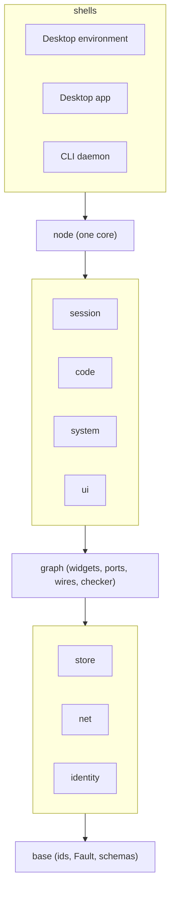

# Rerusted

A powerfully extensible, yet secure and observable desktop, written in Rust.

- The person builds their own apps from building blocks and routes data between them however they like, and can always see which widget reaches what.
- Everything p2p; no server holds state or authority.
- One core, three shells: desktop environment, standalone desktop app, CLI daemon.
- Everything is a widget: something between an app and a component. Ports and wires, no ambient authority.
- No special cases: the master chat, the panel and the settings are widgets like any other.
- Secrets are used, never read. Every store has a scope: `local`, `user` or `team`.
- Only sessions: one master session per user; it is the one place the person talks to.
- Looks like Mint by default, every region replaceable; automatic and in the background.
- Specified and approved before implemented.

## Module map

## Where things live

- [Overview, principles, phases](docs/spec/00-overview.md)
- [Widget graph](docs/spec/01-graph.md)
- [Identity, scopes, sync](docs/spec/02-identity-scopes-sync.md)
- [Primitives and interfaces](docs/spec/03-primitives-interfaces.md)
- [Design, layout, onboarding](docs/spec/04-design-layout-onboarding.md)
- [Code and CI](docs/spec/05-code-ci.md)
- [Dev and test rig](docs/spec/08-dev-rig.md): `cargo vm run` starts the VM tier
- [Decisions and open questions](docs/decisions.md)
- [`design/`](design/): theme tokens, generated hex, logo
- [`crates/compositor/`](crates/compositor/README.md): the compositor spike, with the nested and headless commands (tiers 1 and 2 of the dev rig)
- [`spikes/gpui-shell/`](spikes/gpui-shell/): a gpui window, panel and overlay as clients of the compositor
