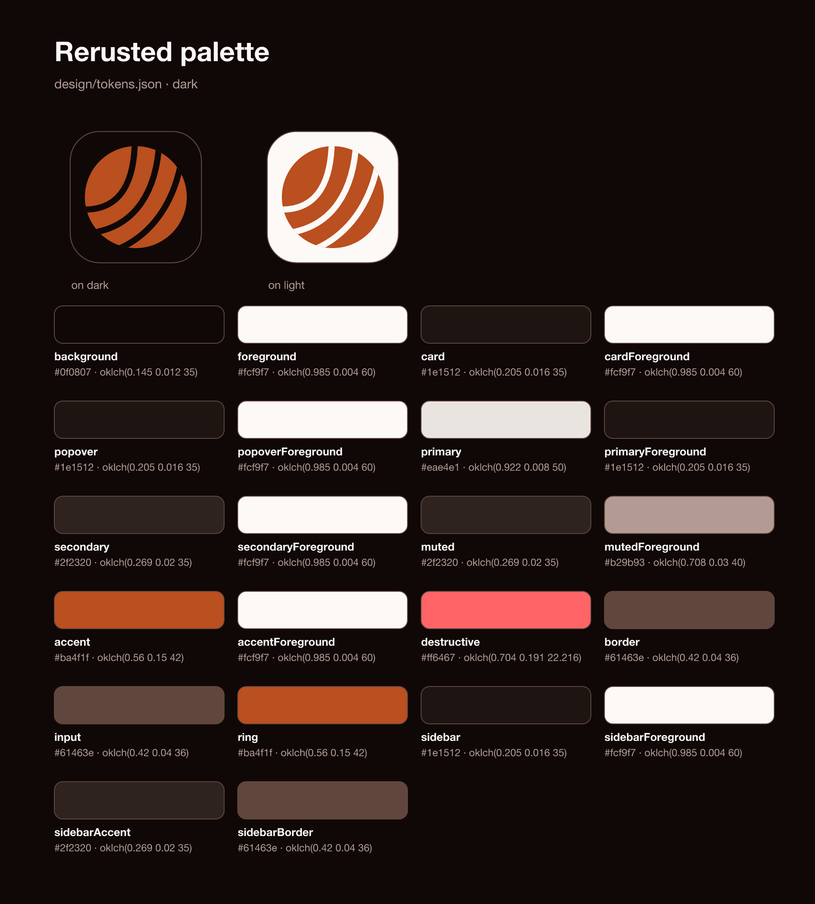

# design

The rusted palette and the logo (#RUST-15, spec in [docs/spec/04-design-layout-onboarding.md](../docs/spec/04-design-layout-onboarding.md)).

| Path | What |
|---|---|
| `tokens.json` | the source of truth, colours authored in OKLCH |
| `tools/` | the generator (its own cargo root, not a workspace crate) |
| `generated/tokens.hex.json` | every OKLCH value with its sRGB hex next to it |
| `generated/contrast.md` | the WCAG AA checks |
| `generated/swatches.svg`, `.png` | the swatch sheet with the logo on dark and light |
| `logo/mark.svg` | the mark in the accent, transparent |
| `logo/mark-on-dark.svg`, `mark-on-light.svg` | app-icon tiles on background and on foreground |
| `logo/mark-mono.svg` | the mark in `currentColor` |
| `logo/png/icon-<size>.png` | app icons, 16 to 1024 |

Everything except `tokens.json` is generated. Never transcribe a colour by hand:

```sh
cargo run --manifest-path design/tools/Cargo.toml             # write
cargo run --manifest-path design/tools/Cargo.toml -- --check  # fail if stale or a contrast check fails
```


