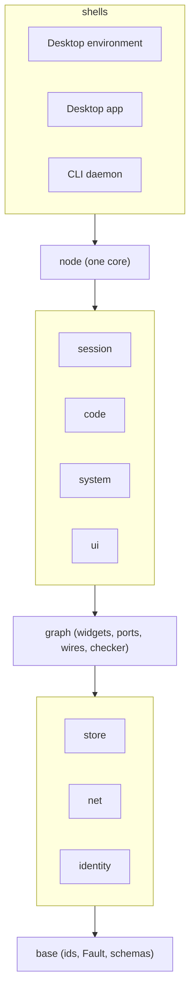
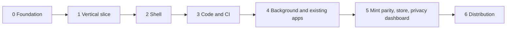

# Rerusted: architecture overview and roadmap

Status: draft
Source: #RUST-18

The record of the 2026-11-10/11 planning thread. Origins: #NEW-10 (the first idea of an own OS) and #V-1 (the rewrite). This board starts clean: new crates with plain functional names, nothing shared with Exponential for now.

## Goal

A powerfully extensible, yet secure and observable desktop. The person builds their own apps from building blocks and routes data between them however they like, and can always see which widget reaches what. Everything p2p; no server holds state or authority.

## Principles

1. **One core, three shells**: desktop environment, standalone desktop app, CLI daemon.
2. **Everything is a widget**: something between an app and a component. Ports and wires, no ambient authority.
3. **No special cases**: the master chat, the panel and the settings are widgets like any other.
4. **Secrets are used, never read.**
5. **Every store has a scope**: `local`, `user` or `team`.
6. **Only sessions**: no separate agent concept. One master session per user; it is the one place the person talks to.
7. **Looks like Mint by default, every region replaceable.**
8. **Automatic and in the background**: worktrees, changes, CI and merges need no manual step.
9. **Specified and approved before implemented** (#V-1).

## Modules

```
 Desktop environment │ Desktop app │ CLI daemon      shells
─────────────────────┴─────────────┴────────────
                     node                        one core
──────────┬──────────┬──────────┬───────────────
 session  │  code    │  system  │  ui
──────────┴──────────┴──────────┴───────────────
        graph  (widgets, ports, wires, checker)
──────────┬──────────┬──────────────────────────
  store   │   net    │  identity
──────────┴──────────┴──────────────────────────
        base  (ids, Fault, schemas)
```

The same layers as a diagram; each layer depends only on the layers below it.



## Specs

| Spec | Issue | File |
|---|---|---|
| Widget graph: ports, wires, checker, labels | #RUST-2 | [01-graph.md](01-graph.md) |
| Identity, teams, scopes, sync, push | #RUST-3 | [02-identity-scopes-sync.md](02-identity-scopes-sync.md) |
| Primitives, interfaces, system providers | #RUST-4 | [03-primitives-interfaces.md](03-primitives-interfaces.md) |
| Design, default layout, onboarding, Mint parity | #RUST-5 | [04-design-layout-onboarding.md](04-design-layout-onboarding.md) |
| Code and CI (phase 3) | #RUST-9 | [05-code-ci.md](05-code-ci.md) |

## Phases

| Phase | Issue | Done when |
|---|---|---|
| 0 Foundation | #RUST-6 | example graphs check correctly, leaks are rejected |
| 1 Vertical slice | #RUST-7 | two devices, no account, same master chat, tasks sync |
| 2 Shell | #RUST-8 | one day of normal use in the VM |
| 3 Code and CI | #RUST-9 | task to merge without a manual step |
| 4 Background and existing apps | #RUST-10 | agent works while a game holds focus |
| 5 Mint parity, store, privacy dashboard | #RUST-11 | Mint checklist ticked |
| 6 Distribution | #RUST-12 | image, installer, server edition |



### Phase 0 rules (#RUST-6)

- Per #V-1: propose the exact types and rules as a plan first and wait for approval. Implement only what was approved. No logic is assumed from Exponential.
- New crates, plain functional names. No `e*` prefix, no `rerusted-*` prefix. The crate called "core" in the planning thread is named `base`, because a crate named `core` shadows Rust's own.
- One crate does one thing, depends only downward, and is usable alone.
- No app, no UI painter, no network in this phase.

Phase 0 is done when:

- `cargo test` is green on Linux and macOS.
- The three example graphs from #RUST-2 pass the checker and the five negative fixtures are rejected, each with a fault that names the path.
- The theme tokens and the logo are in the repo and generated to hex.
- The specs live in `docs/spec/` with diagrams.

## Where the ideas of #NEW-10 landed

| Idea | Lands in |
|---|---|
| whole UI is A2UI on disk, changeable by the agent | #RUST-2, #RUST-5 (local scope, undo) |
| Mint look, Mint default apps rebuilt | #RUST-5, #RUST-11 |
| computer use in the background while gaming | #RUST-10 |
| speech built in | #RUST-4 (`system.voice`), #RUST-12 |
| logins, secrets, permissions | #RUST-3, #RUST-4 (`secrets`, `consent`) |
| p2p app network | #RUST-11 (store); the global network is parked in #RUST-12 |
| desktop environment first, image later | #RUST-8, then #RUST-12 |
| Nix base, isolation, drivers, Steam, ISO, server edition | #RUST-12 |

## Decisions taken

- Rust for everything. Lean only as a model for a few small kernels (the checker rules), not as the implementation language.
- Composition is data (a JSON graph plus terminating expressions). Rust is for primitives; WASM for third-party logic.
- A2UI stays the view format; ports and wires are a manifest above it.
- No GTK or Qt compatibility layer: generated themes, portals, compositor decorations.
- Mint tools are rebuilt by behaviour, never from their code.
- A team is offline when none of its full devices runs.

## Open decisions

1. p2panda or an own signed log (#RUST-3).
2. Painter: own on Vello, zgui, or gpui (#RUST-8).
3. CI runner: own or on an existing Rust runner (#RUST-9).
4. Licence (Apache-2.0 is assumed in #RUST-6).
5. Base system for the image (#RUST-12).

All decisions and open questions, with dates and sources: [decisions.md](../decisions.md).
