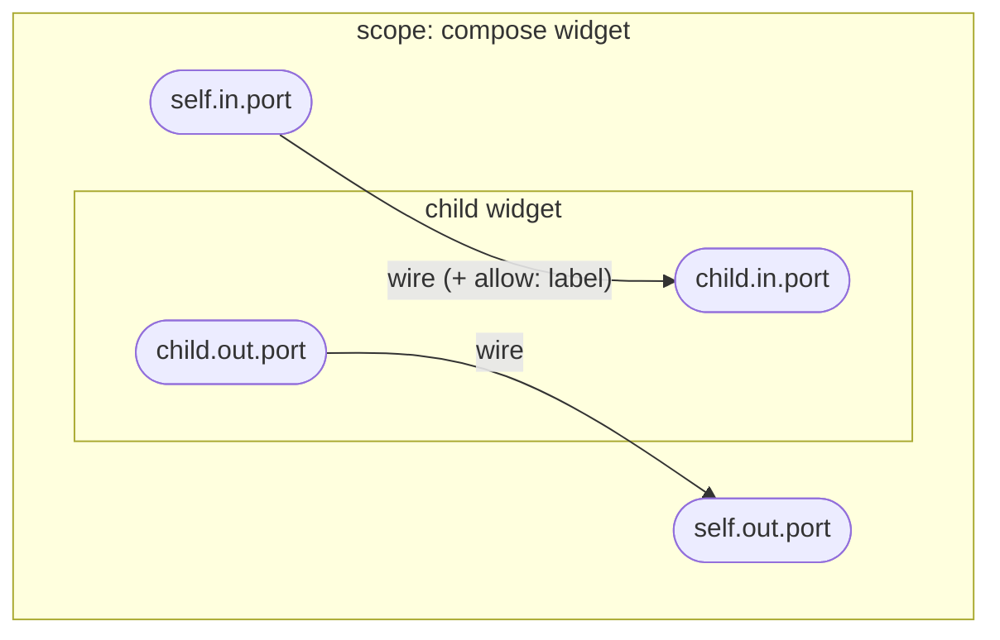
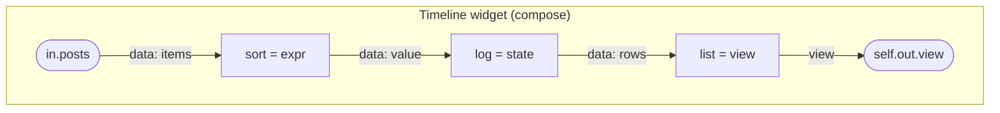

# Spec: widget graph (ports, wires, checker, labels)

Status: draft
Source: #RUST-2

Draft from the 2026-11-10/11 planning thread. Nothing here is final: per #V-1 every rule is approved before it is implemented.

## Idea

The whole desktop is one tree of widgets. A widget is something between an app and a component. It can only touch what is wired into it, so "who can reach what" is a property of the graph and can be checked on every edit.

- **Scopes form the tree.** A scope is a widget boundary. Layout nodes are transparent.
- **Wires form the graph.** The owner of a scope wires its children to each other and to its own ports.

## Data structure

```
Widget {
  in:   { name: Port }
  out:  { name: Port }
  body: Primitive { kind, config }     // axiom, implemented in Rust
      | Compose   { children, wires }  // data only
}

Port = data<Schema>    // a signal; every value carries origin labels
     | call<In, Out>   // a capability that can be invoked
     | view            // an opaque A2UI surface: can be placed, not read

Wire     = from -> to  (+ allow: [label]  set by the scope owner)
from     = self.in.<port>  | <child>.out.<port>
to       = <child>.in.<port> | self.out.<port>
```

A compose widget has no layout of its own. Its layout is a child of kind `view` whose config is the A2UI tree, whose `data` inputs are the bindings and whose `view` inputs are the slots.

```
Timeline widget (compose)
  in.posts ──> sort.in.items        sort   = expr
  sort.out ──> log.in.value         log    = state
  log.out  ──> list.in.rows         list   = view
  list.out.view ──> self.out.view
```

### Diagram: widget scope and wire model

A scope (the compose widget) holds its own ports and its children. Wires go from `self.in` or a child's `out` to a child's `in` or `self.out`. Port kinds: `data` (a signal carrying origin labels), `call` (a capability), `view` (an opaque A2UI surface).



The Timeline example as a diagram:



## Checker rules (run on every edit, errors name the path)

| # | Rule |
|---|---|
| C1 | Every wire endpoint exists; `from` and `to` have the shapes above. This is the "no amplification" rule: a scope can only wire ports it holds. |
| C2 | Port kinds and schemas on both ends of a wire match. |
| C3 | Every required input has exactly one incoming wire. An unwired optional input renders a placeholder ("needs `tasks.list`"). |
| C4 | Fan-out is allowed, fan-in is not. |
| C5 | No cycle in data wires unless it passes through a `state` primitive. |
| C6 | Labels: a primitive output declares the labels it adds and the inputs it depends on (default: all). Labels flow along wires as a union. A sink input declares the labels it accepts. A violation is an error unless the wire carries a matching `allow`. |
| C7 | A widget of kind `code`, `agent` or `process` is a black box: every output carries the labels of every input. |

## What this proves, and what it does not

Proven once for the engine (model or property tests), inherited by every composition:

- a widget observes and invokes only its ports (confinement),
- wiring cannot create authority (C1),
- labels never shrink without an explicit `allow` (C6, C7),
- expressions terminate.

Not provable: that a primitive is implemented correctly, that a widget does what its name says, what a remote service does with data sent to it, what a canvas paints inside its own rectangle.

## Examples to keep as fixtures

1. **Git activity in the sidebar**: a widget with `in.repos: call`, `in.commits: call`, `out.view`, wired to a forge provider at the root.
2. **Twitter pipeline**: egress, sort, log, render.
3. **PhotoCraft by adapter**: a `process` widget whose commands are `call` ports and whose window is its `view`.

Negative fixtures: Twitter data wired into a Discord egress without `allow` (C6), an unwired required input (C3), a schema mismatch (C2), a cycle without state (C5), a wire that names a port outside the scope (C1).

## Open questions

- Label granularity: per provider (`twitter`) or per account and kind?
- Is `allow` per wire enough, or does it need an expiry?
- Dynamic children (one subtree per list item): template in the `view` primitive only, or a `for-each` in compose?
