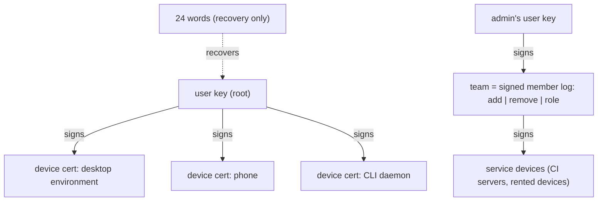
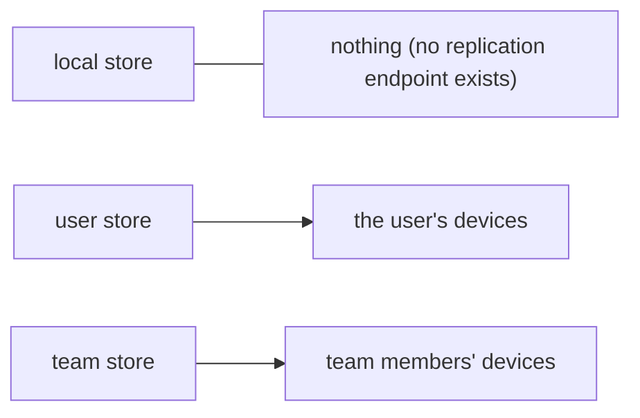
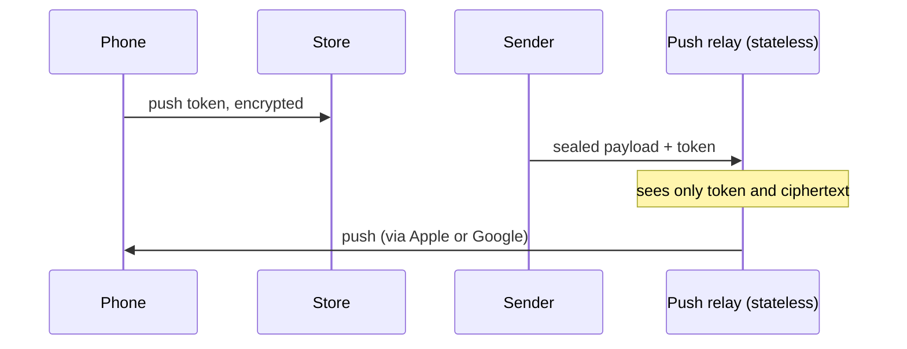

# Spec: identity, teams, scopes, sync and push

Status: draft
Source: #RUST-3

Draft from the 2026-11-10/11 planning thread. Everything p2p, no server that holds state or authority.

## Identity

```
user key  (root, recoverable from 24 words)
   │ signs
   ├── device cert: desktop environment
   ├── device cert: phone
   └── device cert: CLI daemon
team = signed member log: add | remove | role   (signed by an admin's user key)
     + service devices (CI servers, rented devices) signed by the team
```

### Diagram: identity chain



- Device identity is not user identity. A device has its own key that never leaves it; the user key signs a certificate for it, and each device can be revoked alone.
- The 24 words are recovery only (BIP39 over a 32-byte seed, as Brave Sync does). Unlike Brave, the phrase is not the everyday key: a new device is added by scanning a QR on an existing one.
- One user has exactly one master session and one main chat, on every device.

## Teams

- Trust model: team = secure. Join by invite link or QR only.
- An invite is a one-time secret plus the team id plus the inviter's address. It expires and works once. The join only becomes valid when an admin device writes the user key into the member log.
- One symmetric team key, sealed per member, rotated when a member is removed. Enough for small teams.
- Concurrent admin actions follow one fixed rule (decided 2026-11-14): only the owner removes or demotes an admin, so two admins cannot remove each other. Between admins, a removal beats an admission it had not seen.
- A team's always-on peer is whichever full device is running. If none runs, the team is offline. That is accepted.

### The team log's rules

Decided 2026-11-14 and built in the crate `identity` (#RUST-39). The rules are a function of the entries a replica holds, so replicas that hold the same agree.

- **Ranks.** Owner, admin, member. An operation on a device counts only if its author ranks strictly higher than the device and than the role it hands out. Admins admit and remove members; only the owner makes, unmakes or removes an admin; nobody removes the owner.
- **Cuts.** A removal, an admission and a change of role name how many entries of the target's log the author held. The new standing applies from there on. What a device wrote that its removal had not seen is void on every replica.
- **Concurrent operations.** The owner's count. An admin's is void when the owner acted on the same device and neither had seen the other. Between admins, a removal beats an admission it had not seen.
- **Handing over.** The owner hands the team to a member with one operation and stays as admin. What the old owner writes after it in its own log is an admin's. The new owner accepts with an entry that carries the signed handover and acts as owner under it. A handover beats an admin's removal of the new owner that had not seen it.
- **Leaving.** A member takes itself out; the owner hands over first. A leave beats every admission, promotion and handover of the leaver that it had not seen, and a handover that is void this way leaves the old owner the owner.
- **Forks.** A device that signs two entries for one position of its log has forked. The two entries are the proof, and replicas pass it on beside the logs. From the lowest such position on, nothing of that log counts, on any branch; what the device wrote before stays; the device is out for good and joins again as a new device. A device key is therefore never restored from a backup and used again. An accepted handover stands when the old owner forks below it. When the owner itself forks, the team has no owner: members and admins go on, nobody makes or removes an admin.
- **Keys.** One key per epoch, sealed per device. A removal carries the new key. The current key is the newest one held by exactly the current members; when none is (two removals at once, a leave, a fork, an admission that was overruled), the next writer makes one. A device admitted again gets a new key and none of the old ones; a device new to the team gets all of them.

## Scopes

Every store has a scope, enforced by the store, not by policy:

| Scope | Replicates to | Example |
|---|---|---|
| `local` | nothing (no replication endpoint exists) | the desktop's own UI tree and settings |
| `user` | the user's devices | master chat, secrets grants, personal widgets |
| `team` | team members' devices | repos, tasks, team sessions |

### Diagram: replication per scope



## Sync

- Base: signed, hash-chained operation logs per device, materialised into SQLite.
- Rich text: a CRDT document as payload (Automerge or Loro), not as the universal store.
- Repos: git packs straight over iroh.
- Large files: content-addressed blobs.
- Full devices (desktop, daemon) hold everything; phones hold the index and what was opened. Each repo has a pin list of devices.

## Push

The phone writes its push token, encrypted, into the store. The sender sends a sealed payload plus the token to a stateless push relay. The relay is unavoidable (Apple and Google require the app publisher's credentials) and sees only token and ciphertext.

### Diagram: push



## Open decisions

1. p2panda crates (auth, encryption, spaces) behind our own trait, or our own signed log? p2panda is pre-1.0 and says its APIs may still break. Proposed: a spike with two devices and a phone (remove a member, rejoin offline) before deciding.
2. Rented devices hold the team key and are trusted members; the end-to-end claim has to be worded accordingly.
3. Recovery when every device is lost and the words too: none. Is that acceptable?
