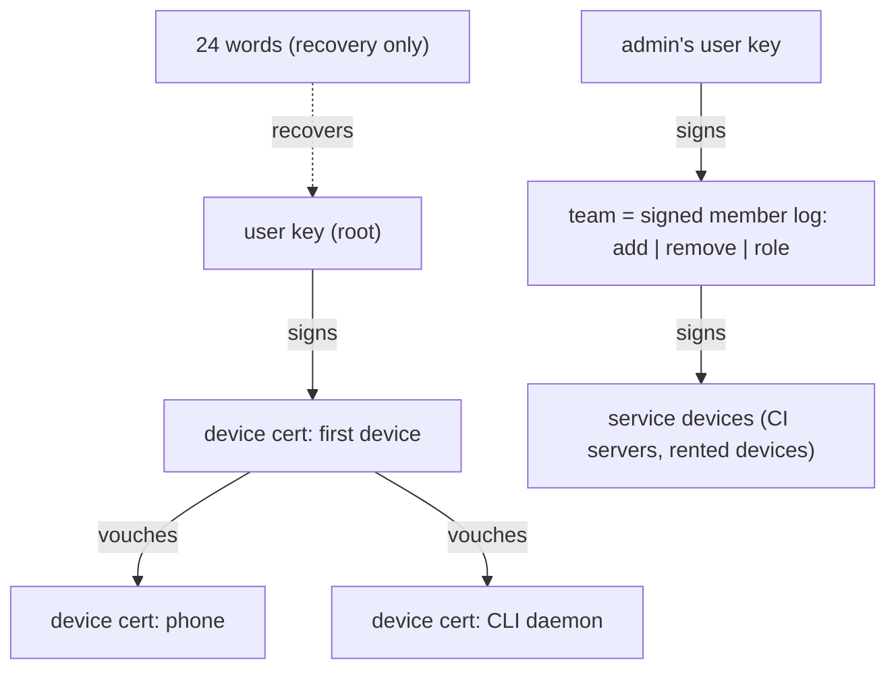
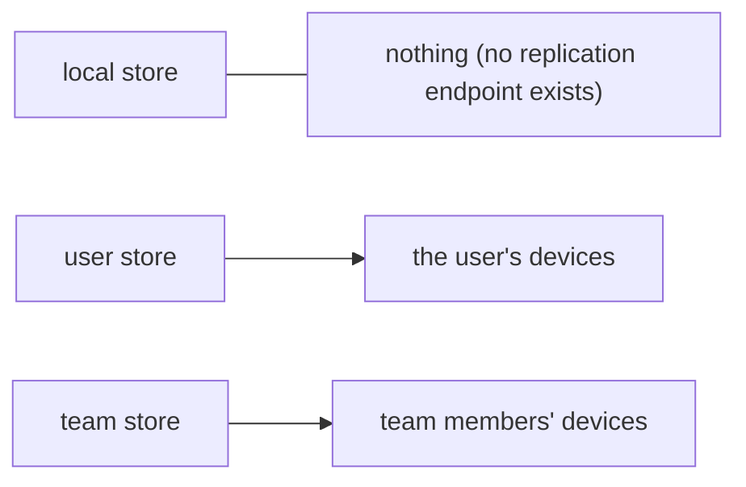
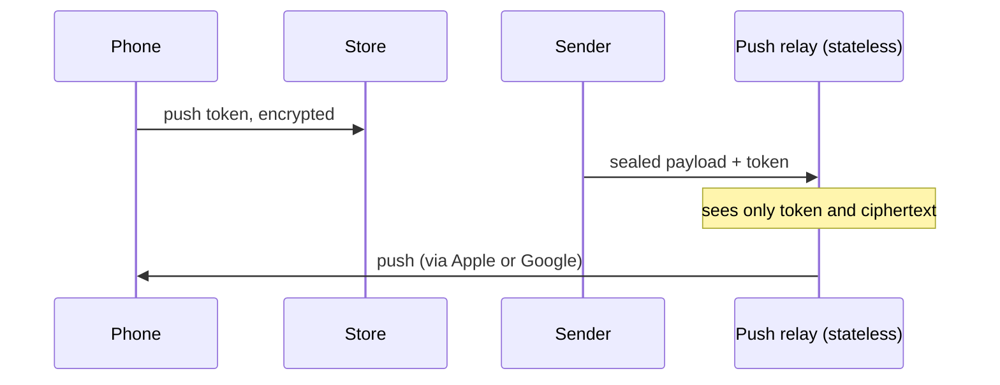

# Spec: identity, teams, scopes, sync and push

Status: draft
Source: #RUST-3

Draft from the 2026-11-10/11 planning thread. Everything p2p, no server that holds state or authority.

## Identity

```
user key  (root, made from the 24 words, stored on no device)
   │ signs
   └── device cert: first device
          │ vouches (a device the user has signs for the next one)
          ├── device cert: phone
          └── device cert: CLI daemon
team = signed member log: add | remove | role   (signed by an admin's user key)
     + service devices (CI servers, rented devices) signed by the team
```

### Diagram: identity chain



- Device identity is not user identity. A device has its own key that never leaves it; the user key signs the certificate of the first one, every later device is vouched for by a device the user already has, and each device can be revoked alone.
- The 24 words are recovery only (BIP39 over a 32-byte seed, as Brave Sync does). Unlike Brave, the phrase is not the everyday key: a new device is added by scanning a QR on an existing one.
- One user has exactly one master session and one main chat, on every device.

### The user key and device certificates

Built in the crate `identity` (#RUST-17), modules `user` and `certificate`. Pure: no clock, no storage.

- **Seed.** A user is 32 random bytes. Whoever holds them is the user.
- **Words.** The seed is shown and typed back as 24 words: BIP39, English list, the seed as the entropy plus 8 checksum bits. A wrong or misplaced word is caught by the checksum. BIP39's second step, which stretches the words into a wallet seed, is not used.
- **User key.** Ed25519; the secret is SHA-256("rerusted/user/1" ‖ seed). The user id is its public key. It is made from the seed when needed and stored nowhere (decided 2026-11-17): it signs the certificate of the first device, and of a device set up from the words.
- **Devices vouch for each other.** A new device is added by scanning a QR on a device the user already has; that device signs the new one's certificate. No words are typed.
- **Device certificate.** 161 bytes: `version (1) | user (32) | device (32) | signer (32) | signature (64)`. The signer is the user key or one of the user's devices, never the device itself; the signature is the signer's over "rerusted/device-certificate/1" and the 97 bytes before it.
- **Chain.** A device proves itself with the certificates that lead from the user key to it: one count byte, then 1 to 16 certificates. The first is signed by the user key, each later one by the device of the one before, all name the same user, no device comes twice.
- **No expiry.** A certificate has no validity window and never runs out (decided 2026-11-17). Nothing in the rules reads a clock.
- **Revocation** is an operation in each team's log (decided 2026-11-14), written by another device of the same user; anyone who outranks the device removes it as before. Devices that a revoked device vouched for stay, unless they are revoked too. Built 2026-11-17, see "One user's devices in a team" below.
- **Owner.** One of a person's devices acts as owner at a time (decided 2026-11-14); moving the role to another of their devices is a handover.

Test vectors: `crates/identity/tests/vectors/`.

## Teams

- Trust model: team = secure. Join by invite link or QR only.
- An invite is a one-time secret plus the team id plus the inviter's address. It expires and works once. The join only becomes valid when an admin device writes the user key into the member log.
  - Built in `identity` (#RUST-44). The invite is 105 bytes: `version (1) | team (32) | inviter (32) | expires (u64) | secret (32)`; it travels outside the log, as a link or a QR code. The secret makes a key pair, and the inviter writes the public key and the expiry into its log (entry kind 13), so nobody else learns the secret.
  - Whoever holds the invite signs a request for one device with that key (161 bytes) and sends it to the inviter. The inviter's device checks the expiry against its own clock and writes the admission (kind 14), which carries the request's signature. Every replica checks that the device asked with that invite, that the inviter wrote the invite into its log before, and that it let nobody in yet. The device comes in as a member; its user's other devices are let in by it.
  - The admission counts as an admin's admission and under the same rules. The log's rules read no clock: an admin that admits after the expiry breaks no rule that others could check, as it could admit the device without an invite.
- One symmetric team key, sealed per member, rotated when a member is removed. Enough for small teams.
- Concurrent admin actions follow one fixed rule (decided 2026-11-14): only the owner removes or demotes an admin, so two admins cannot remove each other. Between admins, a removal beats an admission it had not seen.
- A team's always-on peer is whichever full device is running. If none runs, the team is offline. That is accepted.

### The team log's rules

Decided 2026-11-14 and built in the crate `identity` (#RUST-39). The rules are a function of the entries a replica holds, so replicas that hold the same agree.

- **Ranks.** Owner, admin, member. An operation on a device counts only if its author ranks strictly higher than the device and than the role it hands out. Admins admit and remove members; only the owner makes, unmakes or removes an admin; nobody removes the owner.
- **Cuts.** A removal, an admission and a change of role name how many entries of the target's log the author held. The new standing applies from there on. What a device wrote that its removal had not seen is void on every replica.
- **Concurrent operations.** The owner's count. An admin's is void when the owner acted on the same device and neither had seen the other. Between admins, a removal beats an admission it had not seen.
- **Handing over.** The owner hands the team to a member with one operation and stays as admin. What the old owner writes after it in its own log is an admin's. The new owner accepts with an entry that carries the signed handover and acts as owner under it. A handover beats an admin's removal of the new owner that had not seen it.
- **Leaving.** A member takes itself out; the owner hands over first. A leave beats every admission, promotion and handover of the leaver that it had not seen, and a handover that is void this way leaves the old owner the owner.
- **Forks.** A device that signs two entries for one position of its log has forked. The two entries are the proof, and replicas pass it on beside the logs. From the lowest such position on, nothing of that log counts, on any branch; what the device wrote before stays; the device is out for good and joins again as a new device. A device key is therefore never restored from a backup and used again. An accepted handover stands when the old owner forks below it. When the owner itself forks and no handover of its was accepted, the team has no owner until an admin takes it over (next rule): members and admins go on, nobody makes or removes an admin.
- **Taking over.** After an owner's fork the heir may take the team over with a claim, an entry of its own that names the forked owner. The heir is, of the admins the owners made, the one whose present stay as admin began first in the order of the operations; a demotion or a leave ends a stay. A claim by anybody else does not count. An admin that forked itself is passed over unless it had claimed before its fork. With no admin there is no heir and no owner. An accepted handover of the forked owner stands against a claim: when it turns up, the claim and what was done under it are void. The same when the fork is later proved at a lower position and the heir comes out differently.
- **One user's devices in a team** (decided 2026-11-17, #RUST-42). In the log a member is still a device. Each device publishes its certificate chain in its own log, so every replica knows which devices are one user's; the first chain a device publishes counts, and a device without one, a CI server for instance, is as before. Two operations need no rank, only that author and target are one user's and the author is in the team where the operation stands:
  - **Admit.** A device lets another of its user's devices in, in a role no higher than its own; the owner's device admits as admin at most. It counts like an owner's operation, but gives way to the owner's own word on that device that it had not seen.
  - **Revoke.** A device takes another of its user's devices out, with a cut, whatever their roles. Like a leave it beats every admission, promotion and handover of that device that it had not seen. A removal between two devices of one user is read as a revocation.
  - **Revoking the owner's device** makes the revoking device the owner from its revocation on. What the revoked device did as owner from the cut on is void, an acceptance of a handover included.
  - **Two devices that revoke each other and neither has seen it** are both out; if one was the owner the team has no owner. Nothing in the log says which was first, and any rule that names a winner could be aimed for. A revoked device that has heard of its revocation cannot revoke back: what it writes from the cut on is void. But it can pretend not to have heard and so take the revoker out with it.
  - Whether an author is in the team depends on the other such operations. It is settled by going round: all are taken to count, the team is resolved, those the result does not back are dropped, until nothing changes; operations that go in a circle all count.
- **Keys.** One key per epoch, sealed per device. A removal carries the new key. The current key is the newest one held by exactly the current members; when none is (two removals at once, a leave, a fork, an admission that was overruled), the next writer makes one. A device admitted again gets a new key and none of the old ones; a device new to the team gets all of them.

## Scopes

Every store has a scope, enforced by the store, not by policy:

| Scope | Replicates to | Example |
|---|---|---|
| `local` | nothing (no replication endpoint exists) | the desktop's own UI tree and settings |
| `user` | the user's devices | master chat, secrets grants, personal widgets |
| `team` | team members' devices | repos, tasks, team sessions |

### Diagram: replication per scope



## Sync

- Base: signed, hash-chained operation logs per device, materialised into SQLite.
- Rich text: a CRDT document as payload (Automerge or Loro), not as the universal store.
- Repos: git packs straight over iroh.
- Large files: content-addressed blobs.
- Full devices (desktop, daemon) hold everything; phones hold the index and what was opened. Each repo has a pin list of devices.

## Push

The phone writes its push token, encrypted, into the store. The sender sends a sealed payload plus the token to a stateless push relay. The relay is unavoidable (Apple and Google require the app publisher's credentials) and sees only token and ciphertext.

### Diagram: push



## Open decisions

1. Rented devices hold the team key and are trusted members; the end-to-end claim has to be worded accordingly.

Decided since the draft: our own signed log, not p2panda (2026-11-14, #RUST-39). No recovery when every device and the words are lost; onboarding says so when it shows the words (2026-11-13). The seed is on no device and certificates do not run out (2026-11-17, #RUST-17).
