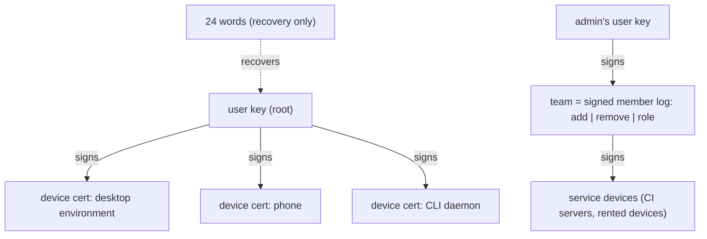
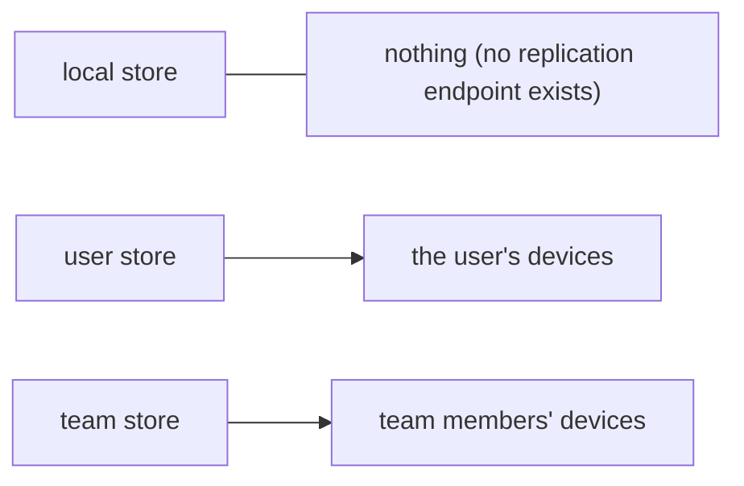
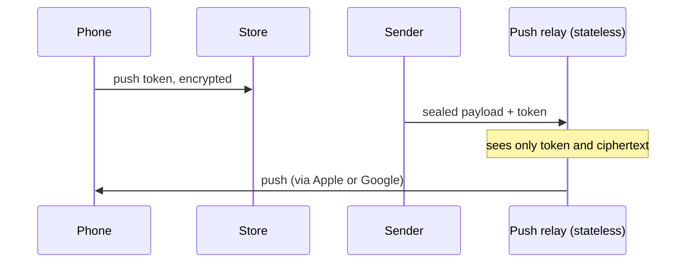

# Spec: identity, teams, scopes, sync and push

Status: draft
Source: #RUST-3

Draft from the 2026-11-10/11 planning thread. Everything p2p, no server that holds state or authority.

## Identity

```
user key  (root, recoverable from 24 words)
   │ signs
   ├── device cert: desktop environment
   ├── device cert: phone
   └── device cert: CLI daemon
team = signed member log: add | remove | role   (signed by an admin's user key)
     + service devices (CI servers, rented devices) signed by the team
```

### Diagram: identity chain



- Device identity is not user identity. A device has its own key that never leaves it; the user key signs a certificate for it, and each device can be revoked alone.
- The 24 words are recovery only (BIP39 over a 32-byte seed, as Brave Sync does). Unlike Brave, the phrase is not the everyday key: a new device is added by scanning a QR on an existing one.
- One user has exactly one master session and one main chat, on every device.

## Teams

- Trust model: team = secure. Join by invite link or QR only.
- An invite is a one-time secret plus the team id plus the inviter's address. It expires and works once. The join only becomes valid when an admin device writes the user key into the member log.
- One symmetric team key, sealed per member, rotated when a member is removed. Enough for small teams.
- Concurrent admin actions need one fixed rule (proposal: the owner wins, then seniority in the log).
- A team's always-on peer is whichever full device is running. If none runs, the team is offline. That is accepted.

## Scopes

Every store has a scope, enforced by the store, not by policy:

| Scope | Replicates to | Example |
|---|---|---|
| `local` | nothing (no replication endpoint exists) | the desktop's own UI tree and settings |
| `user` | the user's devices | master chat, secrets grants, personal widgets |
| `team` | team members' devices | repos, tasks, team sessions |

### Diagram: replication per scope



## Sync

- Base: signed, hash-chained operation logs per device, materialised into SQLite.
- Rich text: a CRDT document as payload (Automerge or Loro), not as the universal store.
- Repos: git packs straight over iroh.
- Large files: content-addressed blobs.
- Full devices (desktop, daemon) hold everything; phones hold the index and what was opened. Each repo has a pin list of devices.

## Push

The phone writes its push token, encrypted, into the store. The sender sends a sealed payload plus the token to a stateless push relay. The relay is unavoidable (Apple and Google require the app publisher's credentials) and sees only token and ciphertext.

### Diagram: push



## Open decisions

1. p2panda crates (auth, encryption, spaces) behind our own trait, or our own signed log? p2panda is pre-1.0 and says its APIs may still break. Proposed: a spike with two devices and a phone (remove a member, rejoin offline) before deciding.
2. Rented devices hold the team key and are trusted members; the end-to-end claim has to be worded accordingly.
3. Recovery when every device is lost and the words too: none. Is that acceptable?
