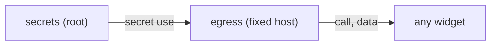
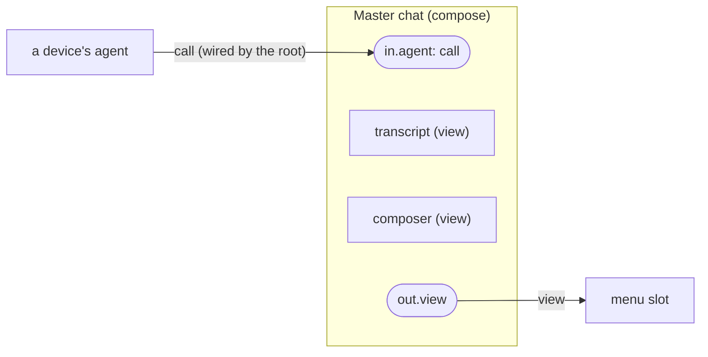

# Spec: primitives, interfaces and system providers

Status: draft
Source: #RUST-4

Draft from the 2026-11-10/11 planning thread. Goal: as few axioms as possible, everything else composed from them.

## Primitives (the trusted base, Rust)

| Kind | Does | Ports |
|---|---|---|
| `view` | renders an A2UI tree from the catalog, including the wgpu canvas | in: data, view (slots) · out: view, events |
| `expr` | pure, terminating expression (map, filter, sort, join) | in: data · out: data |
| `state` | a cell or record set in a scope | in: write (call) · out: data |
| `egress` | one HTTP or MCP endpoint with a fixed host; injects the token | in: secret use · out: call, data |
| `secrets` | holds tokens; never has a data port | out: secret use (to `egress` only) |
| `consent` | the only place a permission prompt is drawn; root only | out: grants |
| `agent` | the agent loop; its tools are exactly its `call` inputs | in: call, data · out: data, view |
| `code` | a WASM component, black box | declared |
| `process` | a sandboxed native process; its window is a `view`, its commands are `call` ports | declared |
| `system.*` | hardware and system services (below) | call, data |

Secrets are used, never read. A Discord widget cannot steal a Twitter token because no widget ever holds one.



## No special cases

The master chat is an ordinary compose widget:

```
Master chat (compose)
  in.agent: call        <- wired by the root from a device's agent
  children: transcript (view), composer (view)
  out.view              -> placed in the menu slot
```

### Diagram: master chat



The panel, the menu, the sidebar, the settings pages and the onboarding wizard are built the same way. Only `consent` and `secrets` have a fixed place, at the root.

## Interfaces (typed, with swappable providers)

| Interface | Providers |
|---|---|
| `tasks` | built-in local, Exponential, Linear, GitHub Issues |
| `code` | local p2p repo, GitHub, GitLab |
| `ci` | own runner, GitHub Actions |
| `llm` | own accounts (Claude Code, Codex), subscription, local model |
| `mcp.<name>` | any MCP server through an adapter: read-only tools become sources, the rest become actions with consent |

A project picks one provider per interface, for example tasks = Exponential, ci = GitHub, code = local. Widgets bind to the interface, never to the provider. Every interface operation is also exported as an MCP tool.

## System providers

One family, thin and typed, over the services Linux already has:

| Provider | Backed by |
|---|---|
| `system.audio` | PipeWire / WirePlumber |
| `system.network` | NetworkManager |
| `system.bluetooth` | BlueZ |
| `system.print` | CUPS |
| `system.power` | UPower |
| `system.disks` | UDisks2 |
| `system.locale`, `system.time` | systemd |
| `system.firmware` | fwupd |
| `system.packages` | apt, Flatpak |
| `system.display`, `system.input`, `system.keyboard` | the compositor |
| `system.camera`, `system.screen` | PipeWire, always behind consent |
| `system.voice` | speech to text, text to speech, wake word |

"Widget X wants the camera" is an unwired `system.camera` input. A portal backend routes the same requests from Flatpak and native apps through the same consent.

Theme and language are data ports from the root (`theme`, `locale`), not slots. Each widget ships its own translations.

## Existing apps

1. **Bundle, no fork**: binary + sandbox profile + manifest. The window lands in a slot; labels are coarse.
2. **Adapter**: an app with an MCP server or CLI exposes its commands as `call` ports. PhotoCraft has more than 500 commands reachable this way.
3. **Fork**: replace the UI layer with A2UI and keep the engine as a process or WASM. Only worth it when core and UI are cleanly separated.

GTK and Qt apps are not ported through a compatibility layer. They get a generated theme (GTK3/4 CSS, Qt, icons, from the tokens), compositor-drawn decorations, portals and AT-SPI.

## Open questions

- Is `process` one primitive, or `process` + a separate `window` view primitive?
- Which interfaces are in the first cut besides `tasks`, `code`, `ci`, `llm`?
- Each `system.*` provider enlarges the trusted base. How are they reviewed?
