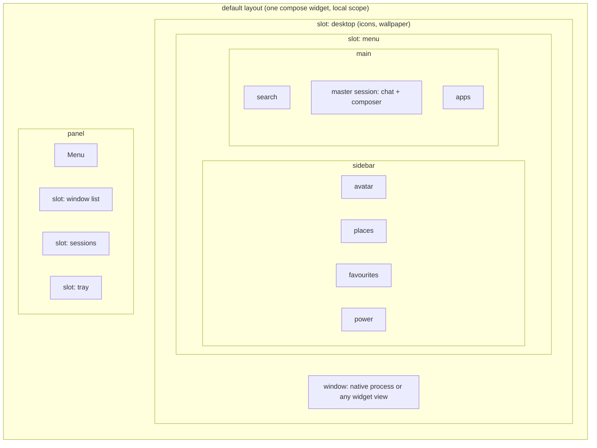

# Spec: design, default desktop layout, onboarding and Mint parity

Status: draft
Source: #RUST-5

Draft from the 2026-11-10/11 planning thread.

## Design

Same design language as Exponential's UI, but rusted: the neutral ramp gets a warm hue around 35° with low chroma, plus one rust accent. Dark first.

| Token | Exponential today | Rerusted proposal | Hex |
|---|---|---|---|
| background | `oklch(0.145 0 0)` | `oklch(0.145 0.012 35)` | `#0f0807` |
| card | `oklch(0.205 0 0)` | `oklch(0.205 0.016 35)` | `#1e1512` |
| muted | `oklch(0.269 0 0)` | `oklch(0.269 0.02 35)` | `#2f2320` |
| border | white 10% | `oklch(0.42 0.04 36)` | `#61463e` |
| muted foreground | `oklch(0.708 0 0)` | `oklch(0.708 0.03 40)` | `#b29b93` |
| foreground | `oklch(0.985 0 0)` | `oklch(0.985 0.004 60)` | `#fcf9f7` |
| accent (new) | none | `oklch(0.56 0.15 42)` | `#ba4f1f` |

Logo: the Exponential mark (circle with the three curves cut out), same shape, filled with the accent. A light theme is derived later from the same hue.

> Approved in #RUST-15 on 2026-11-11: accent A, `oklch(0.56 0.15 42)`, and dark only for now. The approved values, including the tokens not in this table, live in [`design/tokens.json`](../../design/tokens.json); the hex is generated, never transcribed. See [decisions.md](../decisions.md).

## Default layout: like Linux Mint, every region a slot

```
┌──────────────────────────────────────────────────────────────┐
│ slot: desktop (icons, wallpaper)                             │
│                                                              │
│ ┌─ slot: menu ────────────────┐   ┌─ window ──────────────┐  │
│ │ sidebar   │ search          │   │ native process or     │  │
│ │  avatar   │ master session  │   │ any widget view       │  │
│ │  places   │  chat + composer│   └───────────────────────┘  │
│ │  favourites│ apps           │                              │
│ │  power    │                 │                              │
│ └─────────────────────────────┘                              │
├──────────────────────────────────────────────────────────────┤
│ [Menu] [ slot: window list ] [ slot: sessions ] [ slot: tray ]│
└──────────────────────────────────────────────────────────────┘
```

### Diagram: default desktop layout



- The layout is one compose widget in the `local` scope. Replacing a region is rewiring one `view` port.
- Every edit, by the person or by an agent, is a commit in the local repo and has one-click undo.
- The master session sits in the menu. Other sessions show in the panel's sessions slot for debugging; everything works without them.
- Background computer-use sessions appear in the same list with a live tile, take over and hand back.

## Onboarding wizard

A stepper widget shown on first start. It wires the unwired root inputs one after another:

1. Language and keyboard.
2. Identity: create a user key (show the 24 words) or join an existing user by QR.
3. LLM: own account or subscription.
4. Providers: GitHub and others.
5. Pair the phone.
6. Import from Cinnamon (keyboard layout, wallpaper, favourites, panel launchers, display layout, default apps).

## Mint parity

The Mint tools are GPL. The rule from #NEW-10 stands: copy behaviour, never code. So this is a rebuild, in three classes:

| Class | What | How |
|---|---|---|
| Settings pages | display, mouse and touchpad, keyboard, languages, sound, network, Bluetooth, printers, power, date and time, users, themes, startup apps, notifications, privacy | declarative widgets over the `system.*` providers |
| Small tools | calculator, text editor, image viewer, document viewer, system monitor, disk usage, screenshot, notes, archive manager, update manager, software manager, backup, snapshots, USB writer, system information, system administration | rebuilt as widgets, in order of use |
| Heavy programs | partition editor, browser, office, mail, file manager, media player | stay native processes in the generated theme until replaced |

## Open questions

- ~~Light theme now or later?~~ Answered in #RUST-15 on 2026-11-11: dark only for now.
- Which settings pages are in the first usable cut? Proposal: display, sound, network, keyboard, languages, themes.
- File manager: keep Nemo first (as decided for the earlier desktop work) or wrap a Rust one?
