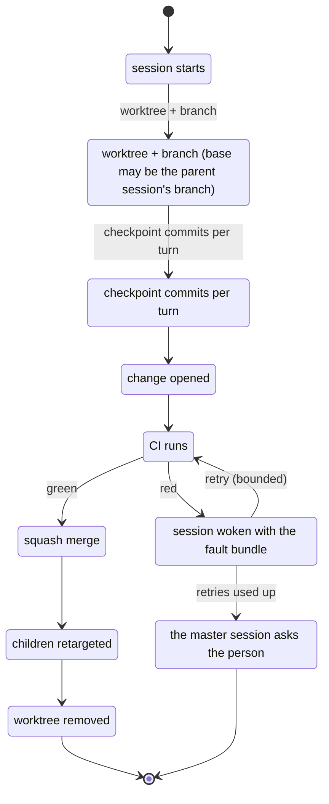

# Phase 3: code and CI (automatic change flow, runner, GitHub and local providers)

Status: draft
Source: #RUST-9

Everything automatic and in the background; the person only hears from the master session when a policy says so.

## One state machine per change

```
session starts
   -> worktree + branch (base may be the parent session's branch)
   -> checkpoint commits per turn
   -> change opened -> CI runs
        green -> squash merge -> children retargeted -> worktree removed
        red   -> session woken with the fault bundle (bounded retries)
                 -> then the master session asks the person
```

### Diagram: change state machine



Auto-merge or approval is a policy per project.

## Providers: three traits, chosen per project

| Trait | Does | GitHub | Local p2p |
|---|---|---|---|
| Remote | where objects go | https | git packs over iroh |
| Forge | the review unit: open, retarget, squash merge, list by base, events (the list in #NEW-36) | pull requests | own review objects in the team store |
| Ci | checks | GitHub Actions | own runner |

- Object store, refs, status, diff, tree merge: gitoxide. Push, rebase and squash are the gaps to fill.
- "Whose main is main" without a server needs one rule (delegates and a threshold, as Radicle does).
- GitHub without a server: no webhooks and no GitHub App. OAuth device flow or a token, plus polling.

## CI

- Planner: workflow YAML in the GitHub format into jobs (matrix, `needs`, expressions).
- Runner daemon in the CLI: two job sources, GitHub (registered as a self-hosted runner) and our planner. `runs-on: [self-hosted, <device>]` assigns CI to a device.
- Jobs run in containers or microVMs.
- Compatibility with community actions is high but never complete: JS actions need Node, Docker actions need a container runtime, cache and artifacts need emulated service endpoints.

## Open decision

Write the runner ourselves, or build on an existing Rust runner (chimera) and write only the planner?

## Done when

From a task to a merged change without a manual step, once on a local repo with our runner and once on GitHub.
