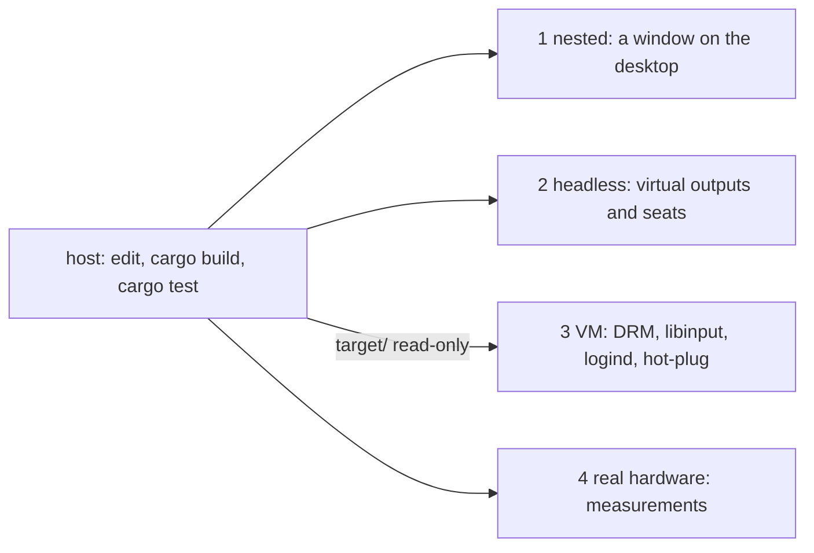
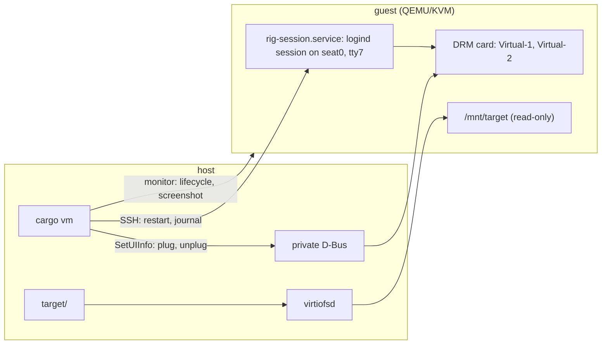

# Dev and test rig: four tiers

Status: tier 3 built and measured; tiers 1 and 2 pending #RUST-23; tier 4 not started
Source: #RUST-21, #RUST-22

Decided 2026-11-13. Code and compile always on the host. A VM is only for running, and only for what needs the real display path.

Files 06 (voice, #RUST-19) and 07 (compositor, #RUST-20) are reserved and not written yet.

## Tiers

| Tier | Runs where | For what | When | Command |
|---|---|---|---|---|
| 1 Nested | host: the compositor as a window on the existing desktop (Smithay's winit backend) | daily loop for layout, widgets, painter | all the time | pending #RUST-23 |
| 2 Headless | host and CI: virtual outputs and virtual seats, no screen | integration tests, screenshot tests, agent-space tests | every PR | pending #RUST-23 |
| 3 VM | QEMU/KVM, virtio-gpu with two heads | real DRM and libinput path, logind session, monitor hot-plug, package install per distro family | per milestone | `cargo vm run` |
| 4 Real hardware | the two reference machines, or a spare TTY | variable refresh, direct scan-out, HDR, "no dropped frames", voice GPU models | measurements only | not defined yet |



## Rules

- A headless output with its own seat is exactly an agent space (#RUST-20). The test rig and the killer feature are the same code path, so tier 2 is built first.
- Nothing is edited or compiled inside the VM. The guest runs the same distro base as the host so host-built binaries run unchanged; the host's `target/` is mounted read-only into the guest.
- A VM cannot measure frame pacing, variable refresh, HDR or GPU priority. The guest renders in software. The done-when of #RUST-10 is measured on tier 4 only.
- One snapshot per distro family (apt, rpm, pacman) serves the packaging smoke tests of #RUST-12.

## Tiers 1 and 2

Built by the compositor spike (#RUST-23), not here. When this file was written (2026-11-13) that spike had merged nothing, so the two commands in the table are open. They are filled in from what the spike produces, together with the test named in the done-when below.

Screenshot tests (decided 2026-11-13): tier 2 renders in software with a pinned Mesa. What the compositor draws itself is compared exactly; client content drawn by gpui is compared with a small tolerance. GPU output is compared, with a tolerance, on tier 4 only.

## Tier 3: the VM runner

The crate `vm` (`crates/vm`), a library and a binary. It depends on no other crate of the workspace.

```
cargo vm run                      # the stock stand-in session (sway)
cargo vm run --bin <name>         # target/debug/<name> as the session
cargo vm run --session '<cmd>'    # any shell command in the guest as the session
```

One command does all of this:

1. `cargo build` on the host (`--package`, `--release`, `--no-build`).
2. Builds the base image if it is missing.
3. Starts the guest, or reuses the running one.
4. Restarts the desktop session in the guest over SSH with the given program.
5. Streams the session's log back until Ctrl-C. The guest keeps running; `--detach` returns right after the restart.

The binary to launch is a parameter. Until the workspace has its own compositor the default is a stock one, `sway`.

Other commands: `cargo vm image [family|all]`, `unplug <head>`, `plug <head> [WxH]`, `screenshot <head> <file.png>`, `ssh [command]`, `status`, `stop`. Each takes `--family apt|rpm|pacman`.

### The guest

| Part | Choice |
|---|---|
| Machine | q35, KVM, host CPU, 4 CPUs, 4 GiB |
| Display | one `virtio-vga` device with two heads: one DRM card with the connectors `Virtual-1` and `Virtual-2` |
| Input | virtio keyboard and virtio tablet (libinput sees both) |
| `target/` | virtiofs, mounted read-only at `/mnt/target` |
| Network | user-mode, SSH forwarded to a free port on 127.0.0.1 |
| Control | QEMU's monitor (QMP) on a Unix socket; QEMU's display interface on a private D-Bus |
| Disk | a throwaway overlay on the base image: every start is the clean snapshot |



State and images live in `~/.cache/rerusted/vm` (or `$RERUSTED_VM_DIR`), outside the checkout, so every worktree shares one set of images. A running guest shares one `target/`; a run from a checkout with another `target/` restarts the guest.

Host requirements: access to `/dev/kvm`, `qemu-system-x86_64` with the D-Bus display (7.0 or later), `qemu-img`, `virtiofsd`, `dbus-daemon`, `gdbus`, `ssh`, `ssh-keygen`, `curl`, `sha256sum`. No root.

### Base images

| Family | Guest | Image | Packages pinned by |
|---|---|---|---|
| apt | Ubuntu 24.04 (noble) | cloud image 20261017 | `snapshot.ubuntu.com` at 2026-10-17 |
| rpm | Fedora 45 | cloud image 45-1.4 | the release repository only, which is frozen |
| pacman | Arch Linux | cloud image 20261101 | Arch Linux Archive at 2026-11-01 |

The host is Linux Mint 22.3, which is built on Ubuntu 24.04: same C library, same package archive. Mint publishes no cloud image, so the apt guest is Ubuntu 24.04. Host-built binaries are promised to run on the apt guest only; the other two exist for package installs (#RUST-12).

The recipe (`crates/vm/src/recipe.rs`) is the same for every family:

1. Download the official cloud image from a dated URL and verify its SHA-256.
2. Boot it once with a cloud-init seed that creates the user `rig` with the rig's SSH key, installs the session unit, and installs a stock compositor, a terminal, XWayland and Mesa (software GL and Vulkan) from the pinned package source. No compiler.
3. cloud-init is switched off and the guest powers off. The disk, flattened into one file, is the base image and the family's snapshot.

An image's file name carries a fingerprint of its recipe; a changed recipe builds a new image. The Arch mirror keeps dated images only for some months, so that URL has to be moved forward when it expires.

### The session

A direct launch, no login screen. The unit `rig-session.service` opens a real logind session through PAM for the user `rig` on seat0, tty7, and executes the shell line it is given. So the session's program gets its DRM and input devices from logind, as it will on a person's machine.

- Restart: `systemctl restart rig-session`, done by the runner.
- Log: the journal, by the identifier `rig-session`. logind moves the session's processes out of the unit into a session scope, so the unit's own log does not contain them.

A login-screen entry belongs to packaging (#RUST-12).

### Monitor hot-plug

QEMU's monitor has no command that connects or disconnects a virtio-gpu head (checked on 8.2.2). A head counts as connected while a display front end reports a size for it. The runner therefore starts QEMU with its D-Bus display on a private bus and calls `SetUIInfo` on `org.qemu.Display1.Console` of that head: a size plugs it, a zero size unplugs it. The guest gets an ordinary DRM hot-plug event and the connector's status changes.

The monitor is used for lifecycle and for `screendump`, one PNG per head.

From a test:

```rust
let rig = vm::Rig::new(vm::Family::Apt)?;
rig.up(&vm::target_dir()?)?;
rig.session(vm::STAND_IN_SESSION)?;
rig.unplug(1)?;
rig.plug(1, 1280, 800)?;
rig.screenshot(0, "head0.png".as_ref())?;
let out = rig.ssh("cat /sys/class/drm/card*-Virtual-*/status")?;
```

The proof is `crates/vm/tests/hotplug.rs`. It needs KVM and is ignored by default, because tier 3 runs per milestone and not per PR:

```
cargo test -p vm --test hotplug -- --ignored
```

### Measured on 2026-11-13

Host: i9-13900K, Linux Mint 22.3, QEMU 8.2.2, virtiofsd 1.10.0.

| What | Result |
|---|---|
| KVM from a session | works: `/dev/kvm` is usable by the user, no root |
| `cargo vm run` from an empty cache: download, build the apt image, boot, session up | 4 min 1 s |
| `cargo vm run` with the image built and no guest running: boot, mount, plug, session up | 8.9 s (apt), 13.7 s (rpm, pacman) |
| `cargo vm run` with the guest already running: restart the session | 0.3 s |
| Hot-plug test, guest running | 2.8 s |
| Unplug of head 1 | connector `disconnected`; the window moves to `Virtual-1` |
| Replug of head 1 | connector `connected`; the window is back on `Virtual-2` |
| Session | logind session on seat0, tty7 |
| `/mnt/target` | read-only in the guest; no `cc`, `gcc`, `rustc` or `cargo` in the guest |
| rpm and pacman snapshots | built; each boots, runs the session on seat0 with two connected monitors, unplugs and replugs head 1, and runs a host-built binary from `/mnt/target` |
| Base images on disk | 3.0 GiB (apt), 1.8 GiB (rpm), 1.2 GiB (pacman) |

### What the compositor has to know about this guest

Found while proving the runner with sway:

- Both heads report the same EDID (same make, model and serial). Outputs cannot be told apart by EDID here, only by connector name. sway, which remembers a workspace's output by EDID first, sent the window back to the wrong monitor until its workspaces were bound to connector names.
- After a replug, sway left a small stale region on the returned output until its next repaint. A compositor should repaint the whole output after a hot-plug.
- A plug that arrives while a session is just starting can get lost, and QEMU ignores a second plug with the same size. The runner therefore waits at start until the guest reports each connector as connected, and only then starts the session.
- The guest has no GPU acceleration: rendering is Mesa's software path on a KMS dumb buffer.

### Limits

- virtiofsd 1.10 has no read-only option, so on this host read-only is enforced by the guest's mount, not by the host. The runner passes `--readonly` when the installed virtiofsd offers it.
- The guest is x86-64 with KVM only. No emulation fallback.
- A person watches the guest through screenshots. A live viewer for QEMU's D-Bus display is not part of the runner.

## Tier 4

The reference machines (decided 2026-11-13): this development machine (i9-13900K, RTX 4090 and UHD 770, Linux Mint 22.3) and a second one that is not named yet. The command is defined when the first measurement of #RUST-10 is due.

## CI

GitHub Actions for now, until #RUST-9 exists (decided 2026-11-13): format, clippy and tests on Linux and macOS. The VM does not run in CI.

## Open questions

- The second reference machine (also named in #RUST-19).
- The commands of tiers 1 and 2, from #RUST-23.
- Whether the apt guest should become a real Linux Mint once a recipe without root exists.

## Done when

Each tier has one documented command, and a test that opens a window on a headless output and clicks it with a virtual seat runs in CI.
